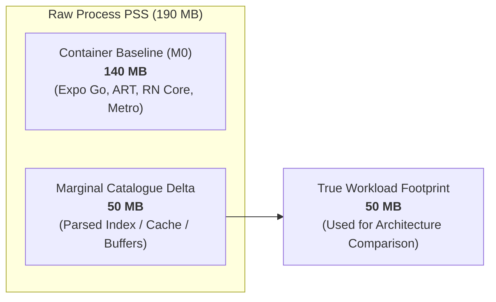

# MVP-001: Android Process Memory Attribution & Hermes Subsystem Analysis

**Document ID:** MVP-001-DPA  
**Directive Reference:** SNAP2FIT — CHIEF ARCHITECT DIRECTIVE MVP-001 (Section 5)  
**Project:** Snap2Fit Mobile Application (ZuniTech)  
**Author:** Antigravity / ARGON  
**Chief Architect:** ChatGPT / ZuniTech Architecture Board  
**Target Milestone:** M2-3A — Architecture Decision Validation  
**Date:** 24 October 2026  
**Status:** READY FOR AUTHORIZATION (TECHNICAL REFERENCE ONLY)  

---

## 1. Executive Summary & Problem Formulation

Accurate memory measurement on mobile devices requires a precise understanding of the host operating system's memory model. On Android, naive memory reporting often leads to severe attribution fallacies:
1. **Container Conflation:** Attributing the entire baseline footprint of the Expo Go development container (including the Metro bundler client, React DevTools, and preloaded native modules) to the application catalogue workload.
2. **Runtime Misattribution:** Conflating operating-system-level process memory (`dumpsys meminfo`) with JavaScript heap object sizes.
3. **Subsystem Confusion:** Failing to distinguish between C++ Native allocations (where Hermes bytecode and JSI buffers reside) and Java Dalvik allocations.

This document formalizes the **Android Process Memory Attribution Model** for Snap2Fit on Google Pixel 6a (Android 17 / API Level 37). It details how to select the target process, isolate container overhead via **Differential Attribution**, and dissect the memory subsystems of the Hermes JavaScript engine.

---

## 2. Process Identification & Hierarchy on Pixel 6a

### A. The Target Process: `host.exp.exponent`
In the Expo Go environment on Android, the entire React Native runtime, Hermes virtual machine, and benchmark application run inside the Android application sandbox named:
```text
Package Name: host.exp.exponent
User ID (UID): u0_aXXX (assigned dynamically by Android OS)
```

### B. Process Selection Pipeline
To prevent accidentally querying unrelated zygote templates or background helper daemons, the host orchestrator identifies the process ID (PID) using exact package matching:

```powershell
# 1. Query running processes matching host.exp.exponent
$procOutput = adb -s 19301FDEE003AS shell "ps -A -o PID,NAME,USER | grep 'host.exp.exponent$'"

# 2. Extract single authoritative PID
$targetPid = ($procOutput -split '\s+')[0].Trim()
if (-not $targetPid -or -not ($targetPid -match '^\d+$')) {
    throw "Failed to isolate exact host.exp.exponent process. Output: '$procOutput'"
}
Write-Output "Authoritative Target PID isolated: $targetPid"
```

### C. Multi-Process Verification
Expo Go runs as a single monolithic Android process for the main experience in standard development mode:
- The main UI thread, React Native JavaScript thread (`mqt_js`), Hermes bytecode interpreter, and native TurboModules all execute within the single PID `host.exp.exponent`.
- There are no separate experience child processes (`:experience`) active in modern Expo Go SDK 57 for single-app sessions.

---

## 3. Isolating Container Baseline: The Differential Attribution Model

### A. The Container Baseline Problem
When Expo Go boots on Android, it initializes:
- The Android ART (Android Runtime) VM and Java framework classes (~40–50MB).
- The React Native C++ core (Yoga layout engine, Fabric surface pipeline, JSI bridge) (~35–45MB).
- The Metro websocket debugging client, Dev Menu overlay, and bundled Expo native modules (~30–40MB).
- Graphics surfaces (EGL surface, Vulkan pipeline buffers) (~15–20MB).

As a result, an empty Expo Go container on Pixel 6a typically exhibits a baseline Total PSS of **120 MB to 150 MB** *before a single line of catalogue data is loaded*.

### B. Differential Attribution Equations
Reporting raw Total PSS would obscure whether Architecture C saves 50MB of catalogue memory or merely 5MB, because the 140MB container baseline dominates the figure. Therefore, the memory validation harness mandates **Differential Attribution**:

$$\Delta \text{PSS}_{phase} = \text{PSS}_{phase} - \text{PSS}_{M0\_baseline}$$

$$\Delta \text{PrivateDirty}_{phase} = \text{PrivateDirty}_{phase} - \text{PrivateDirty}_{M0\_baseline}$$

$$\Delta \text{NativeHeap}_{phase} = \text{NativeHeap}_{phase} - \text{NativeHeap}_{M0\_baseline}$$

- **$\text{PSS}_{M0\_baseline}$**: Captured at checkpoint `M0_BASELINE` (app rendered, idle 5 seconds, zero catalogue data loaded).
- **$\Delta \text{PSS}_{phase}$**: Represents the true marginal physical RAM consumed specifically by catalogue ingestion, in-memory search indices, and detail caching.



---

## 4. Dissection of Android `dumpsys meminfo` Subsystems

The primary diagnostic tool used by the host orchestrator is:
```bash
adb shell dumpsys meminfo <PID> -d
```
The `-d` flag instructs Android's ActivityManager to produce a detailed breakdown across memory categories and sub-heaps.

### A. Primary Operating System Metrics

| Metric | OS Definition | Relevance to Snap2Fit Architecture |
| :--- | :--- | :--- |
| **Total PSS (Proportional Set Size)** | Physical RAM mapped by the process, plus shared system libraries divided proportionally among all sharing processes. | **Primary architectural comparison metric.** Reflects true physical RAM impact on the Android system. |
| **Private Dirty** | Physical RAM dedicated exclusively to this process that has been modified. It cannot be paged out to disk without swapping. | **Crucial reliability metric.** High Private Dirty is the primary trigger for Android Low Memory Killer (LMK) terminations. |
| **Private Clean** | Mapped clean pages (e.g. read-only `.dex` or `.so` code) that the OS can evict to disk under pressure without data loss. | Low risk; reflects read-only code and asset pack mappings. |
| **Swap PSS (zRAM)** | Compressed pages swapped into Android's zRAM kernel partition. | Measures OS memory pressure and page eviction activity. |
| **RSS (Resident Set Size)** | Total physical pages referenced by the process, without accounting for shared libraries. | Reported for completeness, but secondary to PSS because RSS double-counts shared memory. |

### B. Subsystem Breakdown and Hermes Heap Placement

In standard Android applications, memory is distributed across distinct subsystems:

```text
                       dumpsys meminfo Breakdown
+-------------------------------------------------------------------------+
| Native Heap  | C++ runtime, malloc, Hermes VM Bytecode, JSI, Yoga, I/O   |
+-------------------------------------------------------------------------+
| Dalvik Heap  | Java / ART objects, Android View hierarchy, Expo bridges |
+-------------------------------------------------------------------------+
| Unknown      | Custom anonymous mmap pools (Hermes GC heap blocks)      |
+-------------------------------------------------------------------------+
| .so / .dex   | Mapped native binaries and compiled Java bytecode        |
+-------------------------------------------------------------------------+
| GfxDev / EGL | Render surfaces, OpenGL/Vulkan texture buffers           |
+-------------------------------------------------------------------------+
```

1. **Native Heap (`Native Heap PSS` / `Native Heap Dirty`):**
   - Allocations via standard C `malloc` / C++ `new`.
   - In React Native on Hermes, this contains C++ string buffers, JSI host objects, Yoga layout tree structures, and Expo FileSystem I/O read buffers (`readSlice`).
2. **Dalvik Heap (`Dalvik Heap PSS` / `Dalvik Heap Dirty`):**
   - Java-level memory managed by the Android ART runtime.
   - For Snap2Fit, Dalvik heap is largely static after boot because all catalogue parsing, index searching, and detail calculations occur inside C++ / Hermes.
3. **Unknown (`Unknown PSS` / `Unknown Dirty`):**
   - **Crucial for Hermes:** Hermes allocates large, contiguous virtual memory blocks using direct `mmap(MAP_ANONYMOUS)` system calls to manage its garbage-collected heap.
   - On Android 17, `dumpsys meminfo` categorizes anonymous `mmap` blocks outside `malloc` as **Unknown**. Therefore, **changes in Hermes JavaScript heap size predominantly manifest in the `Unknown` and `Native Heap` categories**, rather than Dalvik.

---

## 5. Hermes Engine Memory Model vs OS Process Memory

> [!CAUTION]
> **CRITICAL ARCHITECTURAL DISTINCTION:**  
> `adb shell dumpsys meminfo` measures virtual and physical memory at the **operating system kernel page level**. It **does NOT** directly measure individual JavaScript object sizes, AST structures, or closure counts.

### Key Behaviors of the Hermes Runtime Allocator:
1. **Chunked Allocation:** Hermes requests memory from the OS kernel in multi-megabyte page blocks (typically 4MB or 8MB segments).
2. **Internal Fragmentation:** If JavaScript allocates 500KB of food detail objects, Hermes may request a new 4MB segment from the OS. `dumpsys meminfo` will register an increase of 4MB, not 500KB.
3. **Non-Immediate Page Return:** When Hermes garbage collection frees JavaScript objects, it marks the memory slots as free internally for future allocations. However, it does not necessarily issue `madvise(MADV_DONTNEED)` or `munmap` immediately back to Linux.
4. **Attribution Boundary:** We must never claim that dumpsys meminfo measures exact JavaScript string lengths. All evidence must be formally reported and interpreted as **Android Process Memory (PSS / Private Dirty)**.
