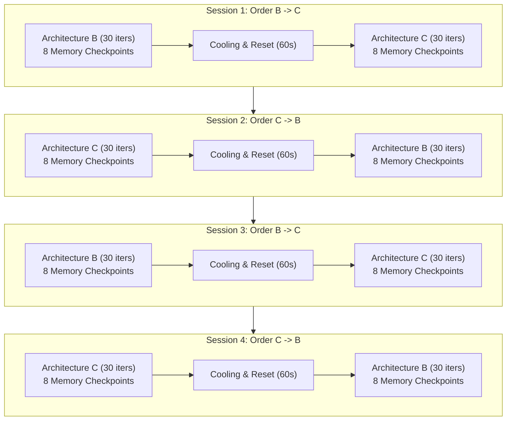
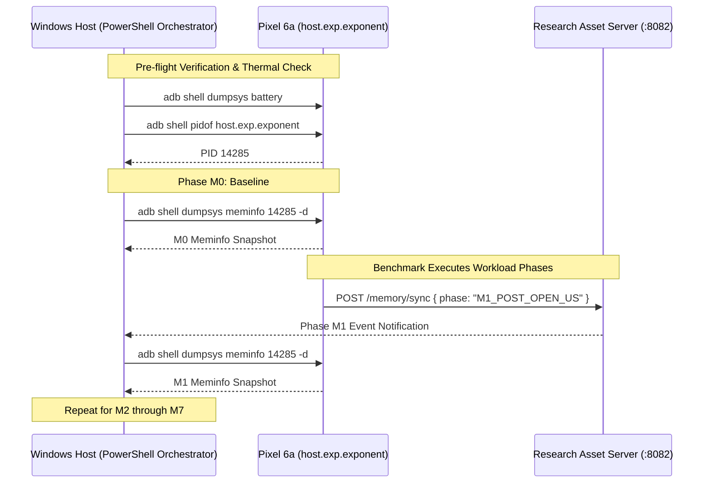

# MVP-001: Physical Android Memory Validation Execution Plan

**Document ID:** MVP-001-MEP  
**Directive Reference:** SNAP2FIT — CHIEF ARCHITECT DIRECTIVE MVP-001  
**Project:** Snap2Fit Mobile Application (ZuniTech)  
**Author:** Antigravity / ARGON  
**Chief Architect:** ChatGPT / ZuniTech Architecture Board  
**Target Milestone:** M2-3A — Architecture Decision Validation  
**Date:** 24 October 2026  
**Status:** READY FOR AUTHORIZATION (PLANNING ONLY — PHYSICAL EXECUTION NOT AUTHORIZED)  

---

## 1. Executive Summary & Purpose

In Milestone M2-3A, physical benchmark Gate C2 demonstrated that **Architecture C (C-split)** provides an **approximately 90% to 92% reduction in catalogue opening latency** (138ms vs 1,416ms) compared to **Architecture B (B-bundle)** on a physical Google Pixel 6a. However, physical memory consumption was classified under Directive ADR-001 as **UNVERIFIED** due to Hermes JavaScript engine and Expo Go sandbox limitations.

This document establishes an **evidence-based, non-intrusive, host-driven memory validation protocol**. It specifies the exact physical setup, multi-session alternating sequence, sampling lifecycle gates, external ADB commands, and risk controls required to quantify real-world Android process memory before final architecture ratification.

> [!IMPORTANT]
> **AUTHORIZATION BOUNDARY:** This document is an execution plan only. **No physical memory measurements, ADB profiling commands, or device runs are authorized under Directive MVP-001.** Physical testing requires a subsequent, explicitly authorized Owner directive.

---

## 2. Experimental Comparability & Hardware Controls

To ensure strict scientific comparability with the historical B30 and C30 benchmark evidence, the memory validation harness enforces identical environmental invariants:

| Parameter | Specification | Comparability Control |
| :--- | :--- | :--- |
| **Physical Handset** | Google Pixel 6a (`bluejay`) | Identical hardware unit (Serial: `19301FDEE003AS`). |
| **Operating System** | Android 17 / API Level 37 | Identical OS build and kernel patch level. |
| **JavaScript Engine**| Hermes 0.78.0 | Bytecode VM bundled inside Expo Go SDK 57. |
| **Runtime Container**| Expo Go SDK 57 (57.0.9 / 57.0.0) | Standard distribution container. |
| **Catalogue Dataset** | 8 files (80,445,082 bytes) | Verified SHA-256: `30c0cbf18d47f6e00bab...` |
| **Catalogue Records** | US: 8,257 records; CA: 5,993 records | Exactly identical data records. |
| **Workload Scope** | 11 core benchmark operations | Search, recipe (138 keys), and LRU cache (166 items). |

### Environmental Pre-Flight Conditions
Before initiating memory sampling, the physical device must satisfy:
1. **Thermal Equilibrium:** Battery temperature must be $\le 34^\circ\text{C}$ (verified via `adb shell dumpsys battery`). If temperature exceeds $34^\circ\text{C}$, a mandatory 5-minute cooling cycle must elapse.
2. **Battery State of Charge:** Connected to high-speed host USB-C port with battery between 80% and 95% to prevent OS low-power throttling or aggressive zRAM compression.
3. **Radio & Network Isolation:** Android **Airplane Mode ENABLED**; Wi-Fi, Bluetooth, NFC, and Mobile Data disabled. Traffic routed strictly through host reverse sockets (`tcp:8081` Metro, `tcp:8082` Collector).
4. **Display & Wakelock:** Screen fixed at 20% brightness; `stay_on_while_plugged_in` enabled (`adb shell settings put global stay_on_while_plugged_in 3`).
5. **Background Quenching:** All non-essential Android tasks terminated via `adb shell am kill-all` to ensure zero CPU/memory competition.

---

## 3. Multi-Session Alternating Block Protocol

To eliminate confounding biases caused by thermal drift, progressive memory fragmentation, or OS page cache retention, the experiment employs an **Alternating Block Design (AB / BA)** across 4 independent sessions:



- **Session Sample Size:** 4 sessions $\times$ 2 architectures $\times$ 8 phase checkpoints = **64 discrete physical memory snapshots**.
- **Container Lifecycle:** Between architecture transitions, Expo Go is cleanly restarted (`am force-stop host.exp.exponent` followed by `am start`) to ensure a pristine JVM/Hermes heap baseline.

---

## 4. Phase Sampling Checkpoints (Lifecycle Gates)

Memory sampling occurs at 8 stationary checkpoints during the execution of each architecture's benchmark run:

| Phase Gate | Trigger Point in Workload | Architectural Subsystem Evaluated | Target Questions |
| :--- | :--- | :--- | :--- |
| **`M0_BASELINE`** | Immediately after Expo Go boots and renders benchmark screen (idle 5s). | Clean Expo Go container + Hermes VM baseline. | What is the base container overhead before loading food data? |
| **`M1_POST_OPEN_US`** | Immediately following `runtime.open("US")` (8,257 records). | Peak ingestion / JSON parse heap expansion. | Does parsing 22.6MB JSON in B create a massive PSS spike vs C? |
| **`M2_POST_OPEN_CA`** | Immediately following `runtime.open("CA")` (5,993 records). | Cumulative multi-market footprint. | How does loading a second market scale memory? |
| **`M3_POST_SEARCH`** | After executing cold, warm, and fallback search passes. | Search index retention and transient query buffers. | Does search index lookup produce uncollected string garbage? |
| **`M4_POST_RECIPE`** | After resolving 138 recipe ingredient keys. | Detail slice reading (`readSlice`) and buffer retention. | Does reading 138 slice packs in C cause buffer retention? |
| **`M5_POST_REPEAT`** | After 50 repeated searches and 10 market switches. | Steady-state heap fragmentation. | Does high-frequency switching leak memory? |
| **`M6_POST_CACHE`** | After completing 166-entry LRU cache pass (454KB). | Active LRU cache high-water mark. | What is the total resident memory when detail cache is full? |
| **`M7_POST_GC`** | After 15 seconds of idle cool-down (Hermes GC settling). | Resident uncollectable set (true retained heap). | What memory cannot be reclaimed by garbage collection? |

---

## 5. Host-Driven Sampling Architecture (Non-Intrusive)

To avoid introducing measurement artifacts inside the JavaScript runtime, sampling is orchestrated externally from the Windows host machine over ADB:



### Exact Sampling Commands (PowerShell / ADB)

#### 1. PID Identification
```powershell
$targetPid = (adb -s 19301FDEE003AS shell pidof host.exp.exponent).Trim()
if (-not $targetPid) { throw "Expo Go process (host.exp.exponent) is not running on device." }
Write-Output "Tracking Expo Go PID: $targetPid"
```

#### 2. Detailed Memory Capture
```powershell
# Capture full structured dumpsys meminfo with detailed breakdown (-d)
$snapshotTimestamp = [DateTimeOffset]::UtcNow.ToUnixTimeMilliseconds()
$meminfoRaw = adb -s 19301FDEE003AS shell dumpsys meminfo $targetPid -d
$meminfoRaw | Out-File -FilePath "research/m2-3a/evidence/memory/raw/$runId-$phase-$snapshotTimestamp.txt" -Encoding utf8
```

#### 3. Battery & Thermal Probe
```powershell
$batteryRaw = adb -s 19301FDEE003AS shell dumpsys battery
$batteryTemp = ($batteryRaw | Select-String "temperature:\s*(\d+)").Matches.Groups[1].Value / 10.0
Write-Output "Current Handset Battery Temperature: $batteryTemp C"
if ($batteryTemp -gt 35.0) {
    Write-Warning "Handset thermal limit exceeded ($batteryTemp C). Pausing for cool-down..."
}
```

---

## 6. Risk Controls, Safety Gates & Abort Conditions

The execution harness must immediately abort if any of the following conditions occur:

| Risk Condition | Detection Mechanism | Abort Action |
| :--- | :--- | :--- |
| **Process Crash / OOM Kill** | `pidof host.exp.exponent` changes mid-session or returns empty. | Halt session immediately; record crash stack in logcat; mark session invalid. |
| **Thermal Throttling** | Battery temperature exceeds $38^\circ\text{C}$. | Pause benchmark; cool handset with external fan; reject affected session data. |
| **Baseline PSS Drift** | M0 baseline PSS drifts $> 20\text{ MB}$ from Session 1 baseline. | Invalidate container state; perform clean container restart. |
| **Network Bridge Drop** | ADB reverse socket ping fails (`curl http://127.0.0.1:8082/health`). | Abort run; restart ADB daemon (`adb reverse tcp:8082 tcp:8082`). |
| **Catalogue Invariant Mismatch** | Correctness records (e.g. 8,257 US records) mismatch. | Invalidate run; catalogue payload corrupted. |

---

## 7. Decision Triggers & Acceptance Criteria

Upon completion of authorized testing, results will be evaluated against predefined architectural acceptance criteria:

1. **Decisive Architecture C Advantage (Recommendation Confirmed):**
   - **Peak PSS Reduction:** Architecture C demonstrates $\ge 25\%$ reduction in Peak Ingestion Delta ($\Delta \text{PSS}_{M1} = \text{PSS}_{M1} - \text{PSS}_{M0}$) compared to Architecture B.
   - **Sustained PSS Parity/Advantage:** Architecture C post-workload PSS ($\text{PSS}_{M6}$) is $\le \text{PSS}_{M6}$ of Architecture B.
   - **Zero Growth Gradient:** PSS slope across repeated iterations $\approx 0$ (no memory leaks).
2. **Inconsequential Memory Outcome (Latency Primary):**
   - Peak PSS reduction is $< 10\%$ (e.g., if native FileSystem slice buffers in C offset JavaScript heap savings).
   - *Result:* Architecture decision rests strictly on CPU/startup latency (90% startup speedup in C justifies selection regardless of neutral memory).
3. **Architecture C Rejection Trigger:**
   - Architecture C demonstrates unbounded memory growth across iterations ($\Delta \text{PSS} > 2\text{ MB/iteration}$), indicating native handle leaks in `readSlice`.
   - *Result:* Architecture C must be blocked from production until leaks are resolved.
