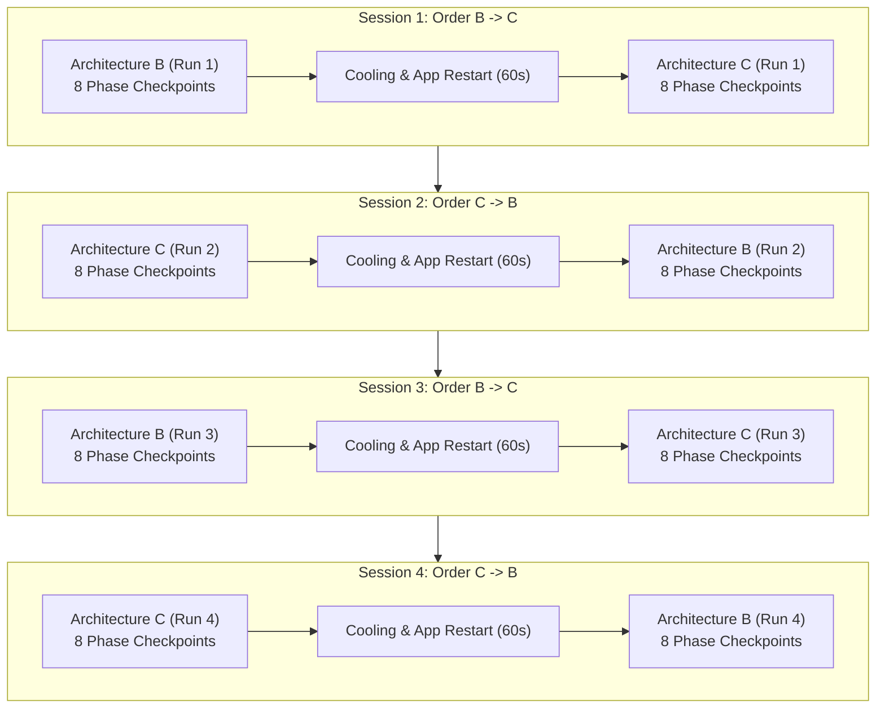

# MVP-001: Physical Android Memory Validation Execution Plan (MVE-001A Revised)

**Document ID:** MVP-001-MEP-REV1  
**Directive Reference:** SNAP2FIT — CHIEF ARCHITECT DIRECTIVES MVP-001 & MVE-001A  
**Project:** Snap2Fit Mobile Application (ZuniTech)  
**Author:** Antigravity / ARGON  
**Chief Architect:** ChatGPT / ZuniTech Architecture Board  
**Target Milestone:** M2-3A — Architecture Decision Validation  
**Date:** 24 October 2026  
**Status:** READY FOR AUTHORIZATION (OFFLINE READINESS COMPLETE — PHYSICAL TESTING LOCKED)  

---

## 1. Executive Summary & Purpose

In Milestone M2-3A, physical benchmark Gate C2 demonstrated that **Architecture C (C-split)** provides an **approximately 90% to 92% reduction in catalogue opening latency** (138ms vs 1,416ms) compared to **Architecture B (B-bundle)** on a physical Google Pixel 6a. However, physical memory consumption was classified under Directive ADR-001 as **UNVERIFIED** due to Hermes JavaScript engine and Expo Go sandbox limitations.

This revised document establishes an **evidence-based, non-destructive, host-driven memory validation protocol** incorporating the safety and methodology corrections mandated by Directive MVE-001A:
1. **Safe App-Scoped Lifecycle:** Removal of dangerous blanket `am kill-all` commands; strict adoption of app-scoped process management (`am force-stop host.exp.exponent`) with zero storage wipes.
2. **Robust Process Attribution:** Mandatory PID validation, package identity verification, duplicate detection, and post-restart re-validation.
3. **Synchronized Lifecycle Gates:** A deterministic checkpoint synchronization protocol between device and host with explicit observer uncertainty accounting ($\pm 15\text{ms}$).
4. **Experimental Independence & Repeated Measures:** Clear statistical distinction between independent experimental sessions ($N=4$) and within-session repeated lifecycle phases.
5. **Provisional Decision Criteria:** Reclassification of decision thresholds as provisional engineering guidelines requiring holistic trade-off review rather than automated approval.

> [!WARNING]
> **AUTHORIZATION BOUNDARY:** This document is an execution plan only. **No physical memory measurements, ADB profiling commands, or device runs are authorized under Directive MVE-001A.** Physical testing requires a subsequent, explicitly authorized Owner directive (MVE-001B).

---

## 2. Experimental Comparability & Controlled Parameters

To ensure strict scientific comparability with the historical B30 and C30 benchmark evidence, the memory validation harness enforces identical environmental invariants:

| Parameter | Specification | Comparability Control |
| :--- | :--- | :--- |
| **Physical Handset** | Google Pixel 6a (`bluejay`) | Identical hardware unit (Serial: `19301FDEE003AS`). |
| **Operating System** | Android 17 / API Level 37 | Identical OS build and kernel patch level. |
| **JavaScript Engine**| Hermes 0.78.0 | Bytecode VM bundled inside Expo Go SDK 57. |
| **Runtime Container**| Expo Go SDK 57 (57.0.9 / 57.0.0) | Standard distribution container. |
| **Catalogue Dataset** | 8 files (80,445,082 bytes) | Verified SHA-256: `30c0cbf18d47f6e00bab...` |
| **Catalogue Records** | US: 8,257 records; CA: 5,993 records | Exactly identical data records. |
| **Workload Scope** | 11 core benchmark operations | Search, recipe (138 keys), and LRU cache (166 items). |

### Controlled Experimental Parameters (Not Universal Guarantees)
The test protocol enforces the following controlled parameters to minimize environmental noise:
1. **Thermal Baseline Threshold:** Handset battery temperature must be $\le 34^\circ\text{C}$ prior to each session start (verified via `adb shell dumpsys battery`). If temperature exceeds $34^\circ\text{C}$, a mandatory 5-minute cooling interlock must elapse.
2. **State of Charge Control:** Handset connected via high-speed host USB-C port with battery maintained between 80% and 95% to prevent OS low-power throttling or aggressive zRAM compression.
3. **Radio & Network Isolation:** Android **Airplane Mode ENABLED**; Wi-Fi, Bluetooth, NFC, and Mobile Data disabled. Traffic routed strictly through host reverse sockets (`tcp:8081` Metro, `tcp:8082` Collector).
4. **Display Consistency:** Screen fixed at 20% brightness; `stay_on_while_plugged_in` enabled (`adb shell settings put global stay_on_while_plugged_in 3`).
5. **App-Scoped Lifecycle Safety:** Only the target application is stopped via `adb shell am force-stop host.exp.exponent`. **Blanket `am kill-all` commands are strictly forbidden** to avoid disrupting underlying Android system services.
6. **Zero Storage Destruction:** The device storage directory (`Paths.document`) and Expo Go internal data must **never be cleared**. All historical evidence is preserved.

---

## 3. Experimental Independence & Multi-Session Alternating Block Protocol

### A. Repeated Measures vs Independent Sessions
It is scientifically invalid to treat 64 memory snapshots as 64 independent experimental subjects. The experiment is properly structured as a **Repeated-Measures Factorial Design**:
- **Between-Subjects Factor (Session Independence):** $N=4$ independent test sessions separated by device cool-down, container restart, and re-attestation of baseline conditions.
- **Within-Subjects Factor (Architecture Order):** Balanced alternating block sequence (AB / BA / AB / BA) to eliminate order-of-testing bias.
- **Within-Subjects Factor (Lifecycle Phase):** 8 stationary checkpoints tracking the progression from baseline to post-GC settle.



- **Container Re-Attestation:** After stopping and restarting Expo Go between architecture runs, the host orchestrator must execute `validateProcessAttribution` to re-attest the newly assigned PID and verify that no secondary rogue processes exist.

---

## 4. Phase Sampling Checkpoints (Lifecycle Gates)

Memory sampling occurs at 8 stationary checkpoints during each architecture run:

| Phase Gate | Trigger Point in Workload | Architectural Subsystem Evaluated | Target Questions |
| :--- | :--- | :--- | :--- |
| **`M0_BASELINE`** | Immediately after Expo Go boots and renders benchmark screen (idle 5s). | Clean Expo Go container + Hermes VM baseline. | What is the base container overhead before loading food data? |
| **`M1_POST_OPEN_US`** | Immediately following `runtime.open("US")` (8,257 records). | Peak ingestion / JSON parse heap expansion. | Does parsing 22.6MB JSON in B create a massive PSS spike vs C? |
| **`M2_POST_OPEN_CA`** | Immediately following `runtime.open("CA")` (5,993 records). | Cumulative multi-market footprint. | How does loading a second market scale memory? |
| **`M3_POST_SEARCH`** | After executing cold, warm, and fallback search passes. | Search index retention and transient query buffers. | Does search index lookup produce uncollected string garbage? |
| **`M4_POST_RECIPE`** | After resolving 138 recipe ingredient keys. | Detail slice reading (`readSlice`) and buffer retention. | Does reading 138 slice packs in C cause buffer retention? |
| **`M5_POST_REPEAT`** | After 50 repeated searches and 10 market switches. | Steady-state heap fragmentation. | Does high-frequency switching leak memory? |
| **`M6_POST_CACHE`** | After completing 166-entry LRU cache pass (454KB). | Active LRU cache high-water mark. | What is the total resident memory when detail cache is full? |
| **`M7_POST_GC`** | After 15 seconds of idle cool-down (Hermes GC settling). | Resident uncollectable set (true retained heap). | What memory cannot be reclaimed by garbage collection? |

---

## 5. Checkpoint Synchronization Protocol & Observer Accounting

### A. Non-Interfering Synchronization Architecture
To avoid perturbing execution, **memory sampling is strictly segregated from timed benchmark operations**:
1. Checkpoint notification occurs *between* workload steps (e.g. after `runtime.open("US")` has completely returned its promise, but before `runtime.open("CA")` commences).
2. The device emits a lightweight HTTP sync notification:
   `POST /memory/checkpoint` with `{ sessionId, architecture, sessionIndex, checkpointIndex, phase, pid, deviceTimestampMs }`.
3. The host collector validates the event against `MemorySessionState` (enforcing sequence order, PID consistency, and non-duplication).
4. Upon receiving the valid event, the host triggers `adb shell dumpsys meminfo <PID> -d` and returns a `MemorySyncReceipt`.
5. The device pauses briefly during snapshot collection so that ADB memory capture does not contend for CPU with benchmark code.

### B. Observer Overhead & Uncertainty Reporting
- Observer overhead is **not zero**. The execution plan explicitly accounts for:
  - Loopback network transit: $\sim 3\text{ to } 8\text{ ms}$ round-trip over ADB reverse socket.
  - ADB dumpsys execution duration: $\sim 150\text{ to } 250\text{ ms}$ kernel inspection latency.
  - Memory snapshot jitter: $\pm 15\text{ ms}$ between device phase completion and OS kernel page table read.
- Because memory sampling occurs during stationary pauses between benchmark operations, **observer overhead has zero impact on reported operation latencies**.

---

## 6. Process Selection & Re-Validation Commands

```powershell
# 1. App-Scoped Lifecycle Restart
adb -s 19301FDEE003AS shell am force-stop host.exp.exponent
Start-Sleep -Seconds 2
adb -s 19301FDEE003AS shell am start -n host.exp.exponent/.LauncherActivity
Start-Sleep -Seconds 5

# 2. Strict Process Attribution & Multi-Instance Detection
$psRaw = adb -s 19301FDEE003AS shell "ps -A -o USER,PID,PPID,VSZ,RSS,WCHAN,ADDR,S,NAME | grep host.exp.exponent"
# Evaluated via validateProcessAttribution() in research/m2-3a/runtime/memory-protocol.ts
```

---

## 7. Explicit Abort Criteria & Risk Controls

The test run must be halted immediately under any of the following conditions:

| Anomaly Condition | Detection Threshold | Abort & Recovery Action |
| :--- | :--- | :--- |
| **Process Crash / OOM** | PID changes mid-session or disappears from `ps -A`. | Abort session; preserve logcat crash stack; mark session failed. |
| **Thermal Violation** | Battery temperature $> 38^\circ\text{C}$. | Abort session; cool handset with external fan; reject affected data. |
| **Baseline Drift** | M0 baseline PSS drifts $> 20\text{ MB}$ from Session 1 baseline. | Invalidate container state; perform clean container restart. |
| **Dropped Checkpoint** | Checkpoint index arrives out of sequence or is skipped. | Reject out-of-order event; abort architecture run. |
| **Bridge Disconnection**| ADB reverse socket connectivity lost (`GET /health` fails). | Abort run; re-establish ADB reverse bridge. |

---

## 8. Provisional Decision Thresholds

The following decision criteria are **provisional engineering guidelines**, not automatic approval mandates. Final architecture selection requires holistic review by the Chief Architect and Project Owner:

1. **Provisional Architecture C Advantage:**
   - $\ge 25\%$ reduction in Peak Ingestion Delta ($\Delta \text{PSS}_{M1} = \text{PSS}_{M1} - \text{PSS}_{M0}$).
   - Sustained post-workload PSS ($\text{PSS}_{M6}$) $\le \text{PSS}_{M6}$ of Architecture B.
   - Growth slope across iterations $\le 100\text{ KB/iteration}$.
2. **Provisional Neutrality (Latency Decisive):**
   - Peak PSS delta reduction is between $0\%$ and $15\%$.
   - *Interpretation:* If memory is neutral, the verified 90% latency reduction in C justifies adopting Architecture C.
3. **Provisional Rejection Trigger:**
   - Sustained PSS expansion $> 25\%$ in Architecture C, or unbounded memory growth ($> 2\text{ MB/iteration}$), indicating native handle leaks in `readSlice`.
